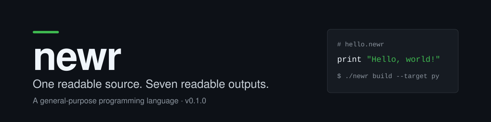
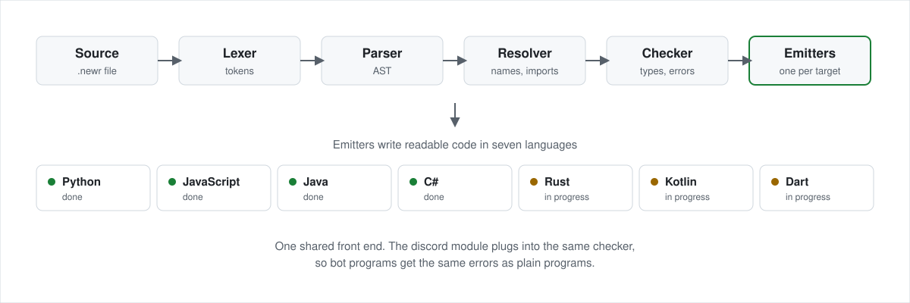

[](BUILD_REPORT.md)
[](SPEC.md)
[](LICENSE)

newr is a general-purpose programming language. You write one readable source file, and the compiler produces readable code in seven target languages. It takes the best ideas from the languages that came before it and puts them in one place, so the same language works for AI code, IT tools, security work, and anything else you build. A Discord bot is one use of newr, through the `discord` module. The language itself is not bot-specific.

## Try it

```sh
git clone https://github.com/drewdestar/newr.git
cd newr
./newr check examples/hello.newr
./newr build --target py -o /tmp/hello.py examples/hello.newr
python3 /tmp/hello.py
```

```
examples/hello.newr: ok
examples/hello.newr: ok, wrote /tmp/hello.py
Hello, world!
```

## An example

`examples/hello.newr`:

```newr
print "Hello, world!"
```

The Python emitter produces readable code, not a blob. This is the whole emitted file:

```python
# Generated by newr from examples/hello.newr. Do not edit by hand.
# Edit the .newr file and rebuild with: newr build examples/hello.newr

print("Hello, world!")
```

The same file builds for JavaScript, Java, and C# today. Rust, Kotlin, and Dart follow in M5. `examples/showcase.newr` shows the other side of the language: a small Discord bot with four commands and two events, written in the same syntax.

## How it works



One front end serves every target. The lexer, parser, resolver, and checker run once, then one emitter per language writes readable code. The conformance corpus decides what correct means: each program in it carries an expected verdict, and every emitter has to produce it. A target that cannot pass does not ship.

## Targets

| Target | Library | Status |
| --- | --- | --- |
| Python | discord.py 2.7.1 | Done in M2 |
| JavaScript | discord.js 14.28.1, Node 24 LTS | Done in M3 |
| Java | JDA 6.7.0 | Done in M4 |
| C# | Discord.Net 3.20.2 | Done in M4 |
| Rust | serenity 0.12.5, poise 0.7.1 | In progress in M5 |
| Kotlin | Kord 0.18.1 | In progress in M5 |
| Dart | nyxx 6.9.1 | In progress in M5 |

## The language, briefly

- Types: `int` (signed 64-bit, checked overflow is a runtime error), `float` (IEEE-754 binary64), `str`, `bool`, `list[T]`, `dict[K, V]`, and more. Nullability is spelled `T?` (for example `str?`); the null value is `none`.
- No implicit numeric coercion: `int` does not convert to `float` implicitly, use `float(x)`. On ints, `/` truncates toward zero, `%` takes the sign of the dividend, and division by zero is a runtime error.
- `while`, recursion, closures and lambdas, ternary `cond ? a : b`, `?.` / `??`, pipeline `|>` (the piped value becomes the first argument: `a |> f(b)` is `f(a, b)`), typed enums, a core `match` statement, runtime-only `requires` / `ensures` contracts, statement-level `?` propagation, `try` blocks returning `Result[T, error]`, `try` / `catch` / `finally`, `pub` visibility, and qualified imports (`import "shop_items.newr"` binds the module under its file stem; call it as `shop_items.price_of(...)`).
- The `discord` module holds the bot surface: `bot` / `command` / `event` declarations, `store` / economy operations, `strings` blocks + `t()`, `task`, and embeds. Bot blocks implicitly import it. General programs use `file` I/O for persistence in v1; a general `db` module is planned for v1.1.

See [SPEC.md](SPEC.md) for the full specification.

## Verification

Numbers from the M4 verification in [BUILD_REPORT.md](BUILD_REPORT.md), section 21.12:

- Full suite: 902 tests, passing in system Python and in a fresh virtual environment.
- Conformance: 74/74 on each of Python, JavaScript, Java, and C#, with 0 failures.
- Goldens: 6/6. Runtime checks: Java 71/71, C# 75/75, JavaScript 61.

## Usage

```sh
./newr check <file.newr>                          # parse, resolve, check; writes nothing
./newr build --check <file.newr>                   # same checks; writes nothing
./newr build --target py|js|java|cs <file.newr>    # emit readable code for the target
./newr build --target py -o <out.py> <file.newr>   # emit to a file of your choice
./newr explain <code>                             # explain a diagnostic code
```

Exit codes: 0 success, 1 usage, 2 environment, 4 build error. There is no exit code 3 in v1, the spec reserves 3 for network errors, which no current command can produce.

## Install

`newr-lang` is not on PyPI yet. Until it is, run newr from a checkout, or build a single-file zipapp:

```sh
python3 -m zipapp . -o newr.pyz
python3 newr.pyz check examples/hello.newr
```

Planned alongside the PyPI release: a pipx install, GitHub Releases, and a PowerShell installer.

## Status

- M0: spec frozen (see [SPEC.md](SPEC.md)).
- M1: front end complete, lexer, parser, AST, resolver, checker, and the discord checker. `newr check` verifies programs; `newr build --check` runs the same checks.
- M2: Python emitter complete.
- M3: JavaScript emitter complete.
- M4: Java and C# emitters complete.
- M5: Rust, Kotlin, and Dart emitters in progress.

See [BUILD_REPORT.md](BUILD_REPORT.md) for per-milestone verification notes.

## Project layout

```
SPEC.md            the language specification (v0.1.0, frozen at M0)
compiler/          the compiler front end and emitters
tests/             front-end test suite (python3 -m unittest discover -s tests)
examples/          .newr examples, plus the v0 golden outputs (hello.py, showcase.py)
conformance/       the conformance corpus: ok/err programs with expected verdicts,
                   the single definition of correct behavior
docs/              error index and diagrams
.github/workflows/ CI
```

## Unverified

- Windows and macOS execution is UNVERIFIED. This project is developed on Linux only; Windows and macOS support will be proven by the CI matrix (ubuntu-latest, macos-latest, windows-latest) once it has run green on all three OSes. It has not run yet.
- Performance numbers are measured on Linux only, per milestone, in [BUILD_REPORT.md](BUILD_REPORT.md) (benchmarks B1-B7). Nothing is claimed for other OSes.

## License

MIT. See [LICENSE](LICENSE).
